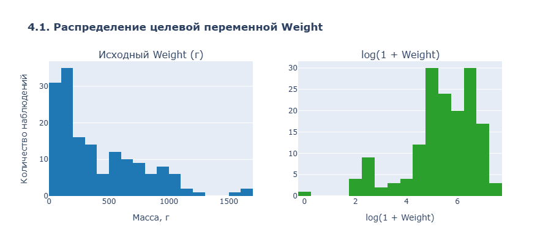
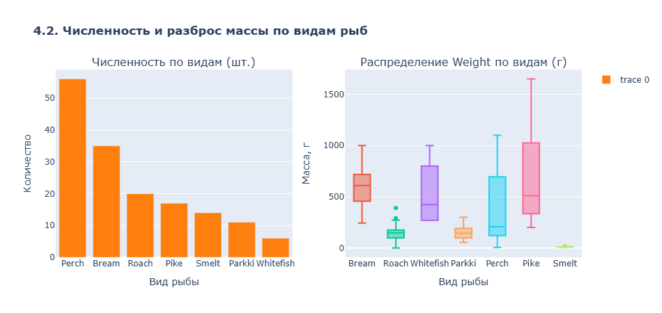
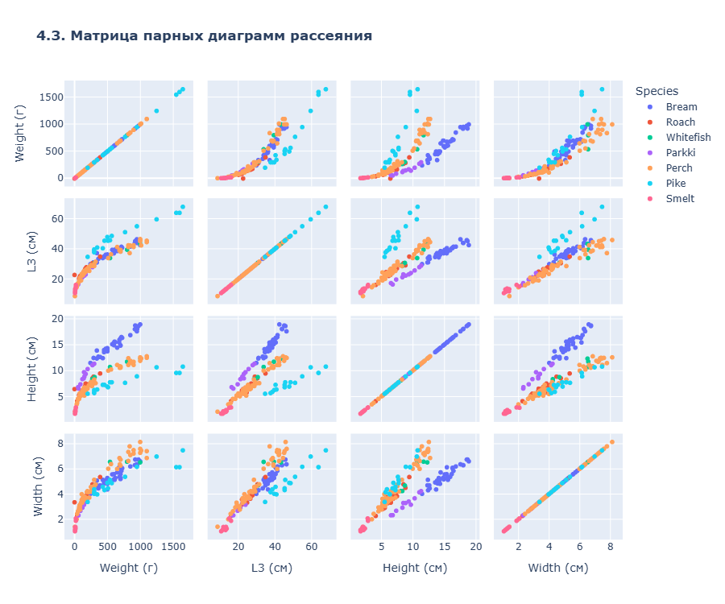
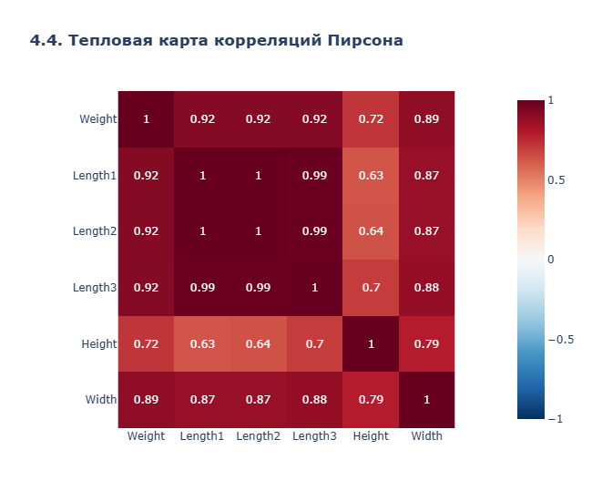
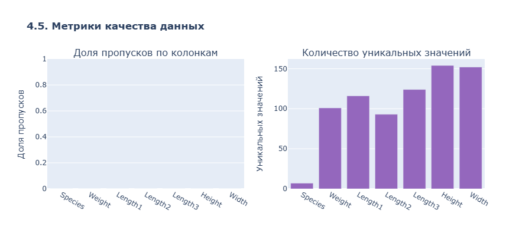
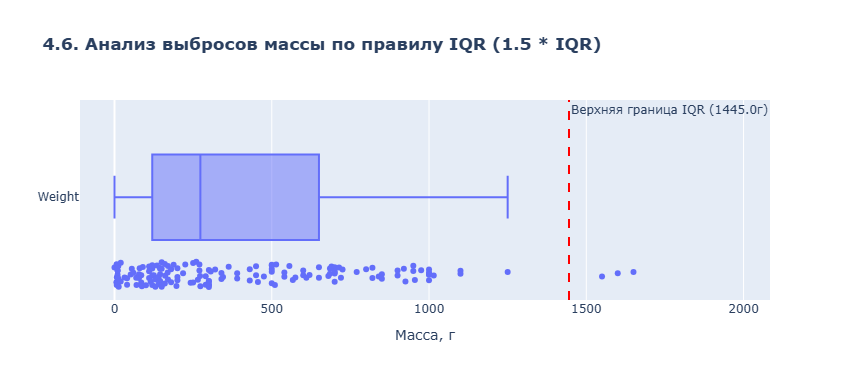
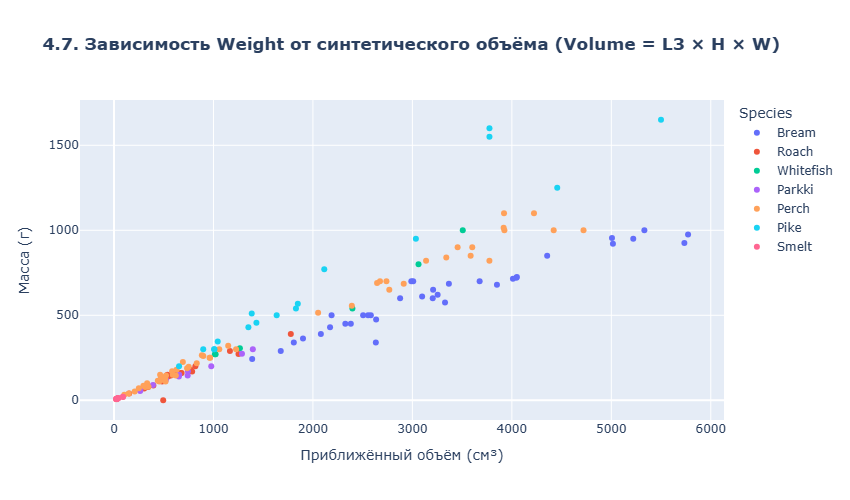

# Отчёт по лабораторной работе №1: исследование данных FishGrow

* **Автор:** Савин Максим
* **Исходный репозиторий:** https://github.com/tylerrussin/Fish-Dimensions-Regression-Analysis
* **Идентификатор исходного коммита:** 1f65547b63c3043e2dcfff0c6435afa993331d4e 
* **Ветка Git:** `lab/01-eda`

## 1. Проверка исходного проекта

### Окружение
* **Версия Python:** 3.13.2
* **Версии библиотек Jupyter-ядра:** pandas 3.0.6, NumPy 2.5.3, Plotly 7.1.0, Dash 4.4.1, dash-bootstrap-components 2.0.4, statsmodels 0.15.0.
* **Команда запуска:** `python run.py`

### Ошибки при запуске и исправления
1. **В Pipfile указана старая версия Python:**
   * *Ошибка:* `Warning: Python 3.7 was not found on your system...`
   * *Исправление:* Указали Python 3.13, добавили Jupyter и Plotly для анализа, затем обновили `Pipfile.lock` командой `pipenv lock`.
2. **Dash Bootstrap Components не принимал параметр `light`:**
   * *Ошибка:* `TypeError: The NavbarSimple component received an unexpected keyword argument: light`
   * *Исправление:* Удалили `light=True` при создании навигационной панели в `app.py`.
3. **В новой версии Dash больше не работает `app.run_server()`:**
   * *Ошибка:* `dash.exceptions.ObsoleteAttributeException: app.run_server has been replaced by app.run`
   * *Исправление:* Заменили `app.run_server(debug=True)` на `app.run(debug=True)` в `run.py`.

## 2. Паспорт данных

| Столбец | Смысл | Тип | Единицы | Назначение | Пропуски | Диапазон  | Проверки |
| :--- | :--- | :--- | :--- | :--- | :--- | :--- | :--- |
| **Species** | Вид рыбы | категория | — | Категориальный признак | Нет | 7 видов: Bream, Roach, Whitefish, Parkki, Perch, Pike, Smelt | нет пустых строк и скрытых дубликатов написания |
| **Weight** | Масса рыбы | числовой | граммы (г) | **Целевая переменная** | Нет |  0 -- 1650 | `Weight > 0`; обнаружено 1 нарушение (`Weight = 0`, Roach) |
| **Length1** | Длина от рыла до жаберной крышки | числовой | см | Признак | Нет | 7.5 -- 59.0 | `> 0`; `Length1 < Length2 < Length3` |
| **Length2** | Длина от рыла до изгиба хвоста | числовой | см | Признак | Нет | 8.4 -- 63.4 | `> 0`; `Length2 < Length3` |
| **Length3** | Длина от рыла до кончика хвоста | числовой | см | Признак | Нет | 8.8 -- 68.0 | `> 0`; наибольшая из 3 длин |
| **Height** | Высота тела | числовой | см | Признак | Нет | 1.73 -- 18.96 | `> 0`; в среднем меньше `Length3` |
| **Width** | Ширина тела | числовой | см | Признак | Нет | 1.05 -- 8.14 | `> 0`; в среднем меньше `Length3` и `Height` |

*Одна строка описывает одну рыбу.*
### 2.2. Роли полей в задаче

* **Что предсказываем:** `Weight`, массу рыбы.
* **Что подаём модели:** `Species`, `Length1`, `Length2`, `Length3`, `Height`, `Width`.
* **Группировка:** `Species` помогает проверять, что виды представлены в частях данных. Пару рыб с одинаковыми размерами также держим вместе при разбиении.
* **ID, служебных полей и дат:** нет.

### 2.3. Пропуски и механизм их появления

* **Пропусков в текущем файле нет**, поэтому заполнять их сейчас не нужно.
* В будущих данных пропуски могут появиться, например, если:
  * `Weight` — ошибка взвешивания, сбой оборудования, потеря записи;
  * `Length1/2/3`, `Height`, `Width` — сбой измерительного прибора, обрыв записи оператором;
  * `Species` — ошибка классификации, потеря метки вида.
* **Если пропуски появятся:** строку без `Weight` не использовать для обучения; пропуски в измерениях заполнять медианой для этого вида. Медиану рассчитывать только по обучающим данным, чтобы не подсматривать в проверочные.

### 2.4. Риски и неопределённости

1. **Неизвестны подробности измерений.** В README указаны граммы и сантиметры, но нет инструкции, как именно измеряли каждую длину.
2. **Возможна утечка данных.** Мы не нашли измерений, сделанных после взвешивания, но без описания процесса сбора нельзя исключить такой риск полностью.
3. **Нулевой вес** у Roach (строка 40) физически невозможен. Строка остаётся в анализе с флагом, но не должна участвовать в обучении модели.
4. **Две щуки с одинаковыми размерами** (строки 142 и 143) имеют разный вес: 1600 и 1550 г. Оставляем обе строки, отмечаем их и отправляем в одну часть при разбиении.
5. **Нет данных о партии или месте вылова.** Поэтому нельзя проверить, связаны ли другие строки между собой.

### 2.5. Источник и воспроизводимость

* **Файл:** `assets/data/Fish.csv`, кодировка UTF-8 с BOM (`utf-8-sig`).
* **Источник:** открытый репозиторий `tylerrussin/Fish-Dimensions-Regression-Analysis`; хеш исходного коммита указан в начале отчёта.
* **Загрузка:** файл читается через `pandas.read_csv(..., encoding='utf-8-sig')`.
* **Проверка файла:** ноутбук ожидает 159 строк и 7 столбцов. Если размер изменится, проверка остановит выполнение и потребует перепроверить анализ.

## 3. Проверка качества данных

### 3.1. Форма таблицы, типы данных и дубликаты

* **Размер:** 159 строк и 7 столбцов.
* `Species` — название вида; остальные столбцы содержат числа.
* Полных копий строк нет.
* Отдельного столбца с ID нет; ни одно поле не уникально во всех строках.

### 3.2. Пропуски, бесконечности и физические ошибки

| Поле | Пропуски (NaN) | Бесконечности (Inf) | Неположительные (<= 0) |
| :--- | :--- | :--- | :--- |
| **Species** | 0 | 0 | — |
| **Weight** | 0 | 0 | **1** (индекс 40, `Weight = 0.0`) |
| **Length1..3** | 0 | 0 | 0 |
| **Height** | 0 | 0 | 0 |
| **Width** | 0 | 0 | 0 |

**Вывод:** Пропусков и бесконечных значений нет. Найдена одна физически невозможная запись: у Roach в строке 40 вес равен нулю.

### 3.3. Проверка соотношения размеров

Проверили, что размеры согласуются между собой:
* `Length1` не больше `Length2`, а `Length2` не больше `Length3`: нарушений нет.
* `Height` и `Width` меньше `Length3`: нарушений нет.
* Все измерения размеров положительные.

**Вывод:** Размеры всех 159 рыб проходят эти проверки. Отдельная ошибка с нулевым весом на проверку размеров не влияет.

### 3.4. Категориальный баланс и редкие виды

| Вид (Species) | Количество (шт.) | Доля | Редкая категория? (<10) |
| :--- | :--- | :--- | :--- |
| **Perch** | 56 | 35.22% | Нет |
| **Bream** | 35 | 22.01% | Нет |
| **Roach** | 20 | 12.58% | Нет |
| **Pike** | 17 | 10.69% | Нет |
| **Smelt** | 14 | 8.81% | Нет |
| **Parkki** | 11 | 6.92% | Нет |
| **Whitefish** | 6 | 3.77% | **Да** |

**Вывод:** Рыб разных видов в наборе неодинаково много. Whitefish всего 6, поэтому при разбиении важно проверять, что этот вид представлен в обучающей и проверочной частях. При этом группы одинаковых измерений нельзя разделять.

### 3.5. Почти одинаковые строки

Найдены две строки с одинаковыми размерами:
* **Строки 142 и 143 (Pike):** `Length1=56.0`, `Length2=60.0`, `Length3=64.0`, `Height=9.6`, `Width=6.144`.
* Масса отличается: 1600 и 1550 г (примерно на 3%).

**Вывод:** Оставляем обе строки, но при разделении данных помещаем их в одну часть. Иначе модель может увидеть почти одинаковые примеры и в обучении, и в проверке.

### 3.6. Уникальность признаков и риски утечки

* Уникальных значений: `Height` — 154, `Width` — 152, `Length3` — 124, `Length1` — 116, `Weight` — 101, `Length2` — 93.
* Ни один столбец не содержит уникальное значение для каждой строки, поэтому явного ID нет.
* По названиям столбцов явных признаков утечки не видно. Время измерений документами не подтверждено, поэтому этот риск остаётся открытым.

## 4. Графики и первичный анализ данных

Графики построены с помощью `plotly`. Код находится в `notebooks/01-eda.ipynb`. Интерактивные версии сохранены как `.html`, изображения — как `.png` в `reports/figures/`.

### 4.1. Анализ распределения массы (Weight)

* **Что показано:** число рыб для каждого диапазона веса до и после преобразования `log(1 + Weight)`.
* **Оси:** X — вес в граммах или его логарифм; Y — число рыб.
* **Вывод:** Большинство рыб весит меньше 500 г, но есть особи весом до 1650 г. Логарифмирование делает большие значения компактнее. Поможет ли оно модели, нужно будет проверять отдельно.

### 4.2. Видовой состав и специфика массы

* **Что показано:** сколько рыб каждого вида есть в данных и как различается их вес.
* **Оси:** X — вид; Y — число рыб или вес в граммах.
* **Вывод:** Чаще всего встречается Perch (56 строк), реже всего — Whitefish (6 строк). Виды отличаются по весу: например, Smelt легче Pike. При разбиении данных нужно учитывать редкий Whitefish и не разносить одинаковые измерения по разным частям.

### 4.3. Матрица рассеяния параметров

* **Что показано:** попарные графики веса, длины, высоты и ширины; цвет обозначает вид.
* **Оси:** значения измерений в граммах и сантиметрах.
* **Вывод:** С увеличением размеров обычно растёт и вес, но связь отличается у разных видов. Цвета образуют отдельные группы, поэтому при построении модели стоит учитывать `Species`.

### 4.4. Корреляционный анализ (Пирсон)

* **Что показано:** насколько линейно связаны числовые столбцы. Коэффициент Пирсона от −1 до +1 описывает линейную связь.
* **Вывод:** Три длины почти повторяют друг друга: их корреляции выше 0.99. Из-за этого коэффициенты линейной модели могут быть нестабильны. `Length3` сильнее других длин связана с весом (`r ≈ 0.92`), но удалять другие признаки автоматически не нужно: решение следует проверять на обучающих данных.

### 4.5. Полнота и уникальность данных

* **Что показано:** доля пустых ячеек и число разных значений в каждом столбце.
* **Оси:** X — название столбца; Y — доля пропусков или число уникальных значений.
* **Вывод:** Пустых ячеек нет. Ни один столбец не уникален для каждой строки, то есть явного ID нет. Больше всего разных значений у `Height` — 154.

### 4.6. Поиск крайних значений по правилу IQR

* **Что показано:** распределение веса и верхняя граница по правилу IQR.
* **Ось X:** вес в граммах.
* **Вывод:** Верхняя граница — 1445 г. Её превышают три Pike весом 1550, 1600 и 1650 г. Это статистические выбросы, но не обязательно ошибки: такие рыбы могут существовать. Поэтому мы их сохраняем.

### 4.7. Связь веса с объёмом, оценённым по размерам

* **Что показано:** вес в сравнении с приближённой оценкой объёма по размерам: `Length3 × Height × Width`.
* **Оси:** X — оценка объёма в см³; Y — вес в граммах.
* **Вывод:** При больших значениях объёма обычно растёт и вес. У разных видов зависимость отличается: одинаковые размеры не обязательно означают одинаковый вес. Объём можно проверить как дополнительный признак модели; пока это гипотеза, а не доказанное улучшение.

### 4.8. Резюме по шагу 4

По графикам можно сделать такие выводы для будущего моделирования:
1. Проверить, поможет ли логарифмирование `Weight`.
2. При разбиении следить, чтобы редкие виды были представлены в частях данных; одинаковые измерения при этом должны оставаться вместе.
3. Проверить, нужны ли модели все три длины: они очень похожи.
4. Оставить крупных Pike: статистический выброс сам по себе не означает ошибку.

## 5. Пропуски и необычные значения

Здесь проверяем вес двумя способами. IQR оценивает обычный диапазон значений по середине данных, а MAD сравнивает каждое значение с медианой. Оба метода отмечают крайние значения, но сами по себе не доказывают, что строка ошибочна.

### 5.1. Анализ отсутствующих значений
Пустых значений в таблице нет.

### 5.2. Статистика по методу IQR
Для веса получили такие значения. Первый квартиль $Q_1$ — граница, ниже которой находится четверть рыб; третий квартиль $Q_3$ — граница, ниже которой находится три четверти рыб:
* Первый квартиль ($Q_1$): 120.0 г.
* Третий квартиль ($Q_3$): 650.0 г.
* Межквартильный размах ($IQR$): 530.0 г.
* **Границы IQR:** $[-675.0; 1445.0]$ г.

За верхнюю границу выходят 3 наблюдения: особи вида Pike с индексами 142, 143, 144 (в исходном CSV) и массами 1550, 1600 и 1650 г. соответственно.

### 5.3. Статистика по методу MAD
Дополнительно применили MAD. Он сравнивает каждое значение с медианой; значение отмечается, если оценка $|z^{MAD}|$ больше 3.5:
* Медиана ($med$): 273.0 г.
* Абсолютное отклонение ($MAD$): 204.0 г.

У самых тяжёлых Pike оценка $z^{MAD}$ составляет примерно 4.22–4.55. MAD, как и IQR, отметил те же три строки.

### 5.4. Физические ошибки данных
Вес 0 не отмечен IQR и MAD: он не выходит за их статистические границы. Но нулевой вес физически невозможен, поэтому отдельная проверка находит строку 40 с Roach. Возможная причина — ошибка измерения или ввода.

### 5.5. Стратегия обработки и экспорт
Решили поступить так:
1. **Нулевой вес:** поставить флаг `flag_error = 1`. Не использовать эту строку при обучении модели веса: нулевой вес невозможен и мешает логарифмировать целевую переменную.
2. **Три крупные щуки:** поставить флаг `flag_outlier = 1`, но оставить строки. Это могут быть реальные рыбы; они нужны, чтобы проверить модель на больших весах.

Таблица с флагами сохранена в `data/processed/fish_checked.csv` для дальнейших экспериментов.

## 6. Проверка гипотез

### 6.1. Физическая гипотеза: объём по размерам связан с весом

Приближённый объём посчитан по размерам: `Volume = Length3 × Height × Width`. Вес в формуле не используется. Чтобы сравнить рыб одного вида между собой, рассчитали корреляцию Спирмена отдельно для каждого вида. Она показывает, растут ли два показателя вместе, даже если связь не строго линейная.

| Вид | Spearman(Volume, Weight) |
| :--- | ---: |
| Parkki | 0.991 |
| Perch | 0.986 |
| Whitefish | 0.986 |
| Pike | 0.982 |
| Smelt | 0.967 |
| Bream | 0.949 |
| Roach | 0.945 |

Во всех семи видах связь сильная и положительная: обычно чем больше объём, тем больше вес. Это поддерживает гипотезу, но не доказывает, что объём сам по себе вызывает увеличение веса. Качество этого признака для модели нужно проверить отдельно.

### 6.2. Проверка связи между тремя длинами

Корреляции Пирсона: `Length1`–`Length2` = 0.9995, `Length1`–`Length3` = 0.9920, `Length2`–`Length3` = 0.9941. Значения близки к 1: три длины меняются почти одинаково и во многом повторяют друг друга. Убирать одну из них автоматически не будем; сначала нужно сравнить варианты модели.

Чтобы передать вид рыбы модели, его можно превратить в отдельные столбцы с нулями и единицами (one-hot encoding). Если появится незнакомый вид, модель должна сообщить об этом или обработать его по заранее выбранному правилу. Кодировщик настраивается только на обучающих данных, не на тестовых.

## 7. Разделение данных и защита от утечки

До обучения разделили данные примерно на 70% для обучения (train), 15% для проверки (validation) и 15% для итогового теста (test). Строки с одинаковыми размерами считаются одной группой и целиком попадают только в одну часть. Зафиксировали начальное значение генератора случайных чисел `seed=42`, чтобы повторный запуск давал то же разбиение. Получилось 111 строк для обучения, 24 для проверки и 24 для теста. Группы не пересекаются. Из-за малого числа Whitefish нельзя гарантировать одинаковую долю каждого вида во всех частях, поэтому результаты для редкого вида нужно оценивать осторожно.

| Возможная проблема | Как её не допустить |
| :--- | :--- |
| Среднее или масштаб рассчитаны по всем данным, включая test | Рассчитывать их только по обучающей части |
| Одинаковые измерения попали и в обучение, и в test | Держать одинаковые размеры в одной группе |
| Индекс строки используется как признак | Не передавать индекс модели |
| Размер измерен после взвешивания | Уточнить порядок измерений: поздний признак может раскрывать ответ |
| Модель выбирают по результату test | Не смотреть на test до финальной проверки |
| Признаки отбирают по всем данным | Выбирать их только на train или внутри кросс-проверки |

## 8. Дополнительное задание: схема и HTML-отчёт

Описание допустимой таблицы находится в `src/fish_schema.json`: там перечислены обязательные столбцы, виды, единицы и диапазоны. Функция `validate_fish_schema` сравнивает данные с этим описанием. Она также отмечает слишком маленький положительный вес: возможно, вес записан не в граммах. Известный нулевой вес остаётся отдельной ошибкой и не исправляется автоматически.

Проверки запускаются командой `pipenv run python -m unittest discover -s tests -v`. Они проверяют исходный CSV, выход веса за верхнюю границу, перевод веса в килограммы и изменение единицы в схеме. Команда `pipenv run python -m src.generate_html_report` создаёт `reports/eda_report.html` со сводкой данных, найденными необычными строками и ссылками на семь графиков.
