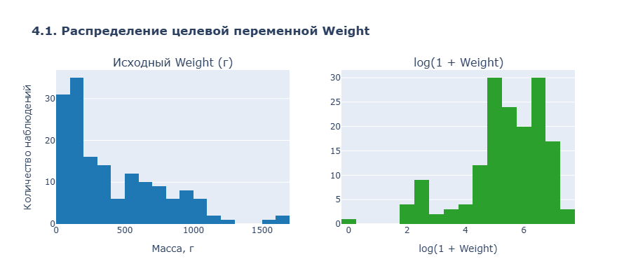
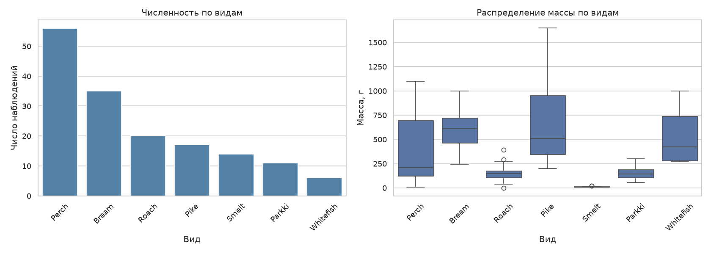
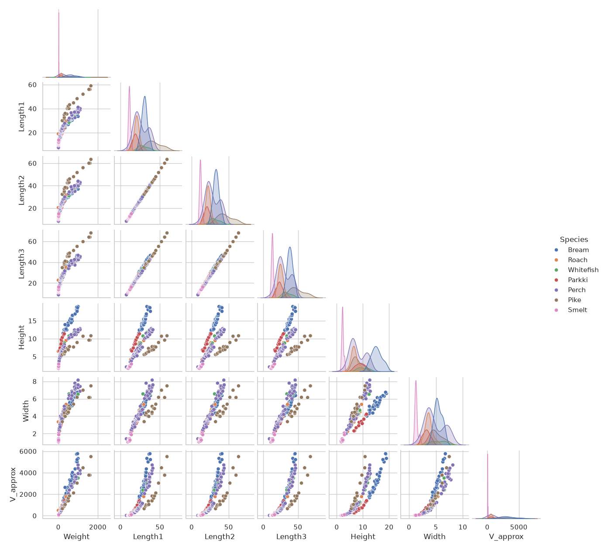
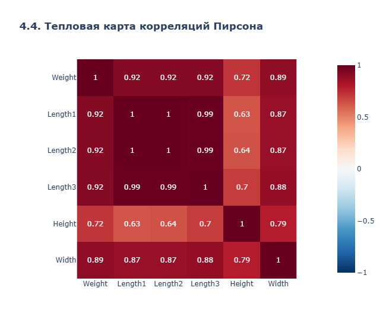
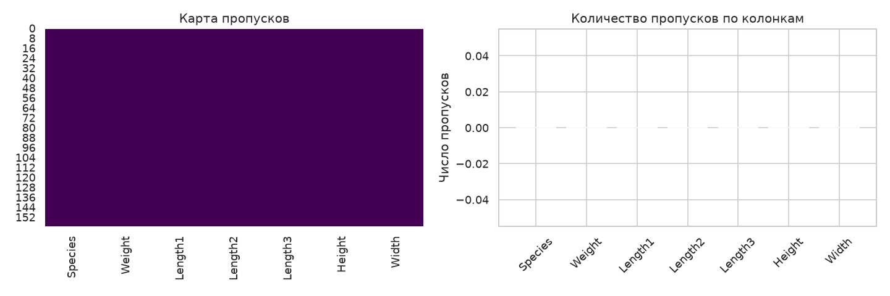
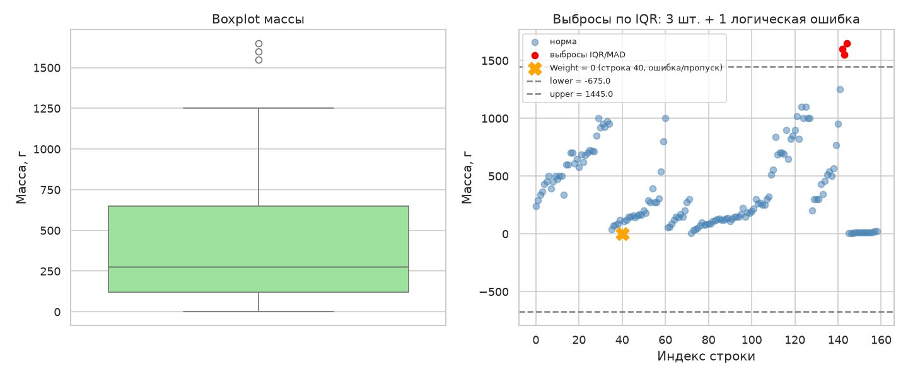
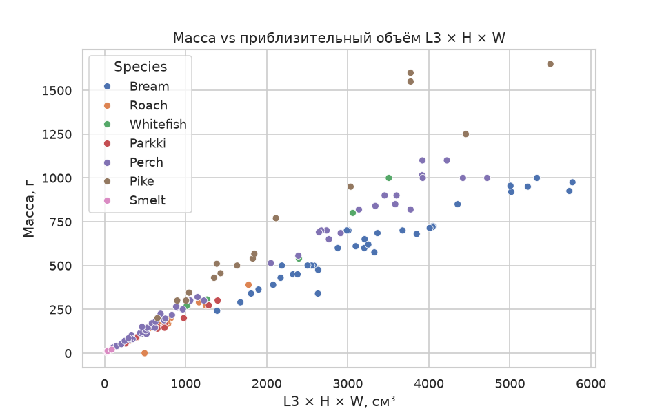

# Лабораторная работа №1. EDA FishGrow

## 1. Окружение
- ОС: Ubuntu
- Python: 3.12.3
- Библиотеки: pandas, numpy, matplotlib, seaborn, scipy, scikit-learn
- Команда запуска: python run.py
- Исходный коммит: 1f65547
- Внесённые фиксы: `light=True` → `color="light"`, `app.run_server` → `app.run`

## 2. Паспорт данных
| Поле    | Смысл              | Тип            | Ед. изм. | Назначение             | Пропуски | Диапазон / проверки                                          |
|------   |--------------------|----------------|----------|------------------------|----------|--------------------------------------------------------------|
| Species | Вид рыбы           | category (str) | —        | Группирующий признак   | Нет      | 7 видов: Bream, Roach, Whitefish, Parkki, Perch, Pike, Smelt |
| Weight  | Масса рыбы         | float          | г        | **Целевая переменная** | Нет      | ≥ 0; в данных есть 0 (строка 40) — подозрительно             |
| Length1 | Вертикальная длина | float          | см       | Признак                | Нет      | > 0; ≤ Length2                                               |
| Length2 | Диагональная длина | float          | см       | Признак                | Нет      | > 0; между Length1 и Length3                                 |
| Length3 | Поперечная длина   | float          | см       | Признак                | Нет      | > 0; ≥ Length2                                               |
| Height  | Высота             | float          | см       | Признак                | Нет      | > 0                                                          |
| Width   | Ширина             | float          | см       | Признак                | Нет      | > 0                                                          |

## 3. Проверки качества
- 159 строк, 7 колонок
- 0 полных дубликатов, 0 ID
- 0 бесконечностей
- 1 строка с Weight = 0 (Roach, index 40)
- 0 нарушений порядка длин
- Редкий вид: Whitefish (3.8%)

## 4. Визуализации

### 4.1. Распределение массы в исходной и логарифмической шкале

**Вывод.** В обычной шкале распределение сильно скошено вправо, логарифм делает его близким к симметричному.

### 4.2. Численность и распределение массы по видам

**Вывод.** Виды представлены неравномерно: Perch и Bream — крупные группы, Smelt и Whitefish — редкие.

### 4.3. Матрица парных графиков

**Вывод.** Длины и ширина связаны с массой линейно; виды образуют отдельные «облака».

### 4.4. Корреляционная матрица

**Вывод.** Length1/2/3 коррелируют почти идеально (r > 0.99) — мультиколлинеарность. Масса сильнее всего связана с Length3 (r ≈ 0.92) и Width (r ≈ 0.89).

**Решения:** оставить один признак (Length3) / PCA / регуляризация (Ridge, Lasso). Автоматическое удаление по порогу корреляции не рекомендуется.

### 4.5. Карта пропусков

**Вывод.** Пропусков нет ни в одной колонке. Однако есть косвенный признак возможных **MNAR-пропусков**: строка 40 (Roach) с `Weight = 0`. Физически масса рыбы не может быть нулевой — это либо ошибка ввода, либо пропуск, закодированный как 0. Без журналов измерений это невозможно проверить, что является риском данных.

### 4.6. Выбросы по IQR

**Вывод.** 3 выброса — три крупные Pike (142–144).

### 4.7. Объём vs масса

**Вывод.** Объём L3×H×W сильно линейно связан с массой внутри каждого вида.

## 5. Пропуски и выбросы
- Пропусков нет
- IQR: 3 выброса (142–144, Pike)
- MAD: те же 3 выброса
- Решение: оставить, это реальные крупные рыбы

## 6. Гипотезы
- H1: объём L3×H×W ↔ масса, r > 0.94 по каждому виду, p << 0.05 
- H2: ANOVA по видам, F=14.95, p=2.11e-13 

## 7. Разбиение и утечки
- Train 60% / Val 20% / Test 20%, стратификация по видам
- Каналы утечки: статистики всей таблицы, повторные строки, ID, постфактум измерения, ручной подбор по test

## 8. Журнал решений
**Журнал решений по аномалиям:**

| Строка  | Признак                 | Значение | Действие                | Обоснование                                       |
|-------- |-------------------------|----------|-------------------------|---------------------------------------------------|
| 40      | Weight = 0              | Roach    | Оставить, добавить флаг |                                                   |
|         |                         |          | `weight_zero`           | Физически масса рыбы не может быть 0.             |
|         |                         |          |                         | Это либо ошибка ввода, либо пропуск,              |
|         |                         |          |                         | закодированный как 0. В обучающую выборку         |
|         |                         |          |                         | такую строку лучше не брать (или брать с флагом), |
|         |                         |          |                         | а в тестовой оставить как «сложный случай».       |
|         |                         |          |                         |                                                   | 
| 142–144 | Weight = 1550–1650,     | Pike     | Оставить                | Это реальные крупные особи. Удаление исказит      |
|         | все размеры согласованы |          |                         | распределение и лишит модель возможности учиться  |
|         |                         |          |                         | на крупных экземплярах.                           |
|         |                         |          |                         |                                                   |